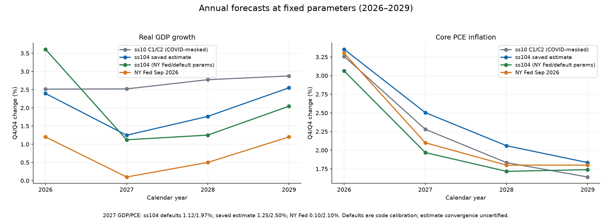

# ss104 forecast at published-code parameters

**Parameter source: DSGE.jl ss104 defaults (the published code's calibration,
not the FRBNY production posterior).** No estimation, optimization, Hessian
calculation, MCMC or parameter draws were run for this forecast.

## Parameter-source check

`docs/DSGE_Model_Documentation_1002.pdf` is absent from the port checkout.
The copy in `outputs/reference/DSGE.jl/docs/` was inspected in full using text
extraction, with visual checks of pages 14 and 26. Its printed date is
**March 3, 2021**, rather than June 17, 2021; SHA-256 is
`66af4ff49fee147abc426eb71ace8a272454a618a7dce7ab26e7ba208e5a79a4`.
Section 4 on page 14 discusses Bayesian inference and refers to the appendix
for priors. Appendix D, pages 26-28, contains distribution, prior mean and
standard-deviation columns, and fixed calibrations. **There is no posterior
mode/mean parameter table.** Prior means were not substituted for estimates;
the label "Model doc 2021-06-17 posterior + DSGE.jl ss104 defaults" does not apply.
The inspected [pinned upstream PDF](https://github.com/FRBNY-DSGE/DSGE.jl/blob/c09dfe881f8809f65b8c0f08a761ec6cc456a6fb/docs/DSGE_Model_Documentation_1002.pdf)
is available with the reference source.

All 130 parameters, including their dated regime values, come from the M6
parameterization at DSGE.jl **c09dfe881f8809f65b8c0f08a761ec6cc456a6fb**:
[m1002.jl](https://github.com/FRBNY-DSGE/DSGE.jl/blob/c09dfe881f8809f65b8c0f08a761ec6cc456a6fb/src/models/representative/m1002/m1002.jl)
and [subspecs.jl](https://github.com/FRBNY-DSGE/DSGE.jl/blob/c09dfe881f8809f65b8c0f08a761ec6cc456a6fb/src/models/representative/m1002/subspecs.jl).
The Python model is built without applying the saved local estimate. Julia
independently builds source ss104 and verifies every parameter in all 29 model
regimes against the exported Python manifest: **maximum absolute error 0**.
The complete parameter values and input hashes are in
[forecast metadata](../data/estimates/ss104_nyfed_params_forecast_metadata.json).

## Annual comparison

GDP and core PCE are exact compounded Q4/Q4 percentage changes. The NY Fed
column uses the published mean forecasts from the
[September 18, 2026 release](https://libertystreeteconomics.newyorkfed.org/2026/09/the-new-york-fed-dsge-model-forecast-september-2026/),
also preserved in `data/public/nyfed_dsge_20260918/nyfed_dsgeTableData.csv`.
The Julia columns use its independently computed forecast, with the same
population and reporting conversion as Python.

| Year | GDP ours (NY Fed params) | GDP Julia | GDP NY Fed Sept 2026 | PCE ours | PCE Julia | PCE NY Fed |
|---|---:|---:|---:|---:|---:|---:|
| 2026 | 3.609023 | 3.609023 | 1.2 | 3.062900 | 3.062900 | 3.3 |
| 2027 | 1.122585 | 1.122585 | 0.1 | 1.968315 | 1.968315 | 2.1 |
| 2028 | 1.250566 | 1.250565 | 0.5 | 1.716821 | 1.716821 | 1.8 |
| 2029 | 2.044897 | 2.044897 | 1.2 | 1.738949 | 1.738949 | 1.8 |

For reference, the existing re-estimated "mode" rows are below. Their saved
optimizer status is `time_limit`; convergence remains uncertified. These
values were read from the existing CSV, with no re-estimation or change to
the estimate. See [the M7 report](ss104_forecast_comparison.md).

| Year | GDP ours (saved re-estimate) | PCE ours (saved re-estimate) |
|---|---:|---:|
| 2026 | 2.394571 | 3.353029 |
| 2027 | 1.247718 | 2.504511 |
| 2028 | 1.764752 | 2.060362 |
| 2029 | 2.550557 | 1.834207 |

## Identical local data and forecast conventions

- The inputs are the existing October 6 FRED and non-FRED snapshots plus
  `ss104_survey_ffr_local.csv`, with local as-of date October 12, 2026.
  The unmasked transformed history matches the existing modal forecast's
  history exactly, including missing observations.
- Presample: 1959Q3-Q4; history: through 2026Q2. The Q2 population HP-filter
  sample is preserved and the separately transformed partial Q3 is appended,
  exactly as in `scripts/forecast_ss104_mode.py`.
- Semi conditioning in 2026Q3 retains nominal rate, spread, long rate and
  the available six expected-FFR observations. GDP/core PCE and other Q3
  observations are masked before filtering. The historical gap initialization,
  2020Q4-2021Q4 rate masks and pre-2008Q4 zero anticipated-policy-shock
  variances are preserved. There is one conditional quarter and 39 subsequent
  deterministic quarters, through 2036Q2.
- Quarterly GDP/core PCE: `100 * expm1(4 * quarterly_log_percent / 100)`.
  GDP adds the terminal population trend of **0.2674725873 quarterly log
  percentage points**, held constant, as in the modal forecast. Its annual
  log contribution is **1.0698903491 pp**. Annual growth is
  `100 * expm1(sum(four quarterly log-percent growth rates) / 100)`;
  2026 combines actual Q1-Q2 with model Q3-Q4. FFR is four times the quarterly
  nominal rate. Complete annual years are 2026-2035; 2036 is partial.

## Same-input Julia check

`forecast_ss104_nyfed_params.jl` uses Julia **1.8.5**, the existing pinned
oracle environment, the shared M6 economic-method overlay, and the actual
StateSpaceRoutines.jl filter/smoother at
**794fb02ff45a62537d8d5d037c1d12b3aa7e4574**. Both source checkouts were clean.
It reads the exported effective transformed CSV, verifies its SHA-256, dates,
observable names, conditioning mask and dated regime path, and then runs the
reference deterministic smoother and `DSGE.forecast`. No Python states,
system matrices or forecast values are supplied to Julia.

The comparator checks the Julia filter input against the Python effective
history, maps pseudo-observable columns by name, exports the Julia paths,
and verifies the saved Python CSVs against their model-unit paths. The
complete comparison covers **40 quarters and 10 complete annual years**.

| Comparison | Maximum absolute error (percentage points) |
|---|---:|
| Quarterly annualized GDP | 1.222093e-6 |
| Quarterly annualized core PCE | 1.985032e-7 |
| Quarterly FFR | 5.066204e-8 |
| Annual GDP Q4/Q4 | 4.247434e-7 |
| Annual core PCE Q4/Q4 | 1.901471e-7 |

All five forecast checks pass the explicit **1e-5 percentage-point** tolerance.
Raw model-unit errors for GDP/core PCE/FFR are
**2.850889e-7 / 4.857523e-8 / 1.266551e-8**. The scored log likelihoods,
including the conditional quarter but excluding two presample quarters,
are Python **-6340.517802593065** and Julia **-6340.517811319675**:
absolute difference **8.726610e-6**. Likelihood is reported as a diagnostic;
the forecast gate does not claim the controlled M6 likelihood tolerance
passes on this longer, actual-data history. Existing M6 gates are unchanged.
The [parity JSON](../data/estimates/ss104_nyfed_params_parity.json) records
the full measurements, source commits, data hashes and oracle hash.

## Gap explanation

The defaults forecast exceeds the published annual GDP mean by
**2.4090 / 1.0226 / 0.7506 / 0.8449 pp** in 2026-2029. Its core PCE gaps are
**-0.2371 / -0.1317 / -0.0832 / -0.0611 pp**. The Julia comparison makes a
material translation error an unlikely explanation for these release gaps
at the selected parameters and inputs. It does not identify each cause's
contribution; no alternative-data or posterior experiment was run.

- **Posterior versus defaults.** Public source defaults are a starting
  parameterization, with dated policy/COVID calibration. They are not a
  verified September 2026 production posterior. The document supplies
  priors rather than a posterior parameter vector. The local re-estimate
  is another parameter vector and is not a certified converged mode.
- **SME and OIS coverage.** The July 2026 SME FFR path is present, and
  one September 2024 workbook supplies sparse historical survey coverage.
  The full historical SME/SPD panel is absent. All six historical OIS
  columns `obs_nominalrate1`-`obs_nominalrate6` are missing; they remain NaN.
  The expected-rate survey channels are distinct from these OIS channels.
- **Anticipated GDP, nowcast and SPF inputs.** `obs_gdp1` is entirely missing.
  This replay uses the modal run's semi conditioning and does not supply
  GDP/core PCE nowcasts or the release-specific SPF short-run inflation
  expectations. The September release uses August SPF Q3 GDP/core PCE
  forecasts and short-run inflation expectations, July market rate
  expectations and financial yields. Thus even an identical production
  posterior would not make this conditioning set a release reproduction.
- **Vintage and population.** The public data are a later October snapshot,
  including revisions and partial Q3 financial observations, rather than
  the September production vintage. The survey availability date is a
  conservative local bound, not its original publication date. Population
  growth is the modal run's fixed terminal HP-trend approximation rather
  than a verified production population forecast.
- **Mode/point path versus posterior mean.** This run forecasts conditional
  state means at one fixed vector of code defaults. The saved re-estimate
  also yields a point path. The released columns are forecast means over
  the production distribution; nonlinear parameter-to-forecast mappings
  and exact growth compounding can make that average differ from a path
  evaluated at a parameter mode or mean. No uncertainty bands are inferred
  from this fixed-parameter replay.

## Artifacts and reproduction

- Python [quarterly CSV](../data/estimates/ss104_nyfed_params_forecast_quarterly.csv)
  and [annual CSV](../data/estimates/ss104_nyfed_params_forecast_annual.csv).
- Julia [quarterly CSV](../data/estimates/ss104_nyfed_params_julia_forecast_quarterly.csv)
  and [annual CSV](../data/estimates/ss104_nyfed_params_julia_forecast_annual.csv).
- The local `outputs/ss104_nyfed_params/` bundle contains raw/effective transformed
  observations, model-unit paths, forecast arrays, metadata, Julia HDF5 and log.
  Reproduction commands are in the [oracle README](../tools/oracle_julia/README.md).
- Run `scripts/plot_ss104_enhancements.py` to regenerate `outputs/plots`.
  The four inspected PNGs, [captions](plots/captions.md) and
  [parameter comparison](plots/key_params.md) are copied into `docs/plots/`.

Work is restricted to `ss104-port`. No push or force-push is part of this task;
main remains at `6716227be0ed573cd45f6f04fd38cb15a5807c37`.

Validation: **214 targeted pytest tests passed** across the new forecast
reporting/conditioning tests and the ss104, regimes, survey FFR, Model1002,
forecast, oracle tools and data tests. Repo-wide Ruff lint and format checks
passed (**84 Python files**). All four plot PNGs were visually inspected;
their committed copies match `outputs/plots` byte for byte. The same-input
Julia forecast comparison passed as shown above. No estimation was run.
